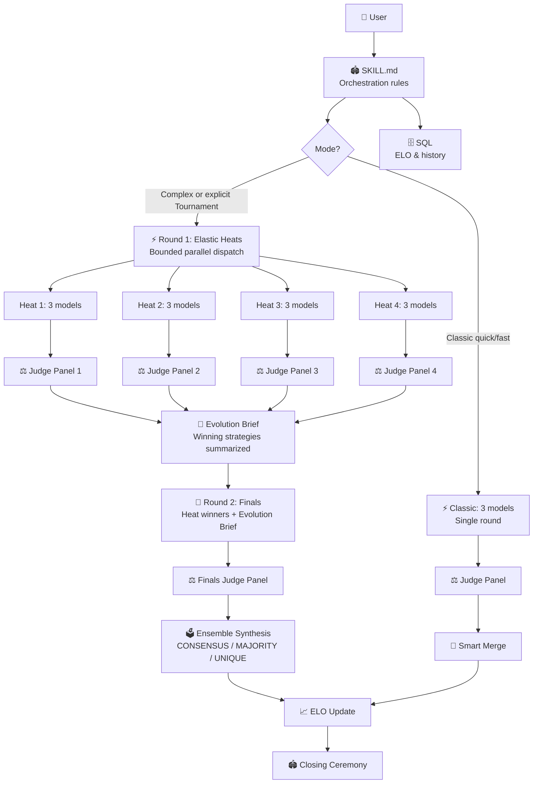

# 🏟️ Havoc Hackathon

**Pit AI models against each other. Score them sealed. Crown a winner. All built using the GitHub Copilot CLI. ⚡**

[](https://github.com/features/copilot)
[](LICENSE)
[](SECURITY.md)

> ### ⚡ One Command. That's It.
>
> **Never used the CLI before? No problem.** Follow these 3 steps:
>
> **1. Open your terminal**
> - 🍎 **Mac:** Press `⌘ + Space`, type **Terminal**, hit Enter
> - 🪟 **Windows:** Press `Win + X`, choose **Terminal** or **PowerShell**
> - 🐧 **Linux:** Press `Ctrl + Alt + T`
>
> **2. Paste this line and press Enter:**
> ```bash
> curl -fsSL https://raw.githubusercontent.com/DUBSOpenHub/havoc-hackathon/main/quickstart.sh | bash
> ```
> *Already have the CLI? No worries — this detects it and skips straight to adding the skill.*
>
> **3. When GitHub Copilot opens, type:** `run hackathon`
>
> That's it — let the models compete! 🏟️
>
> *Requires an active [GitHub Copilot subscription](https://github.com/features/copilot/plans). [Get one here →](https://github.com/features/copilot/plans)*

---

<p align="center">
  
  <br />
  <sub>▲ Preview of an elastic tournament: ELO leaderboard → heats → finals → ensemble synthesis → winner reveal · <code>python3 docs/demo/demo.py</code> to run locally</sub>
</p>

---

## 🤔 What Is This?

**Havoc Hackathon** is a multi-model orchestration skill for the [GitHub Copilot CLI](https://docs.github.com/copilot/concepts/agents/about-copilot-cli) that turns your terminal into a competitive arena. Give it any task, code, copy, design, architecture, naming, anything, and it dispatches the current selectable GitHub Copilot model roster in tournament elimination heats, scores them with sealed judge panels, evolves the best ideas between rounds, synthesizes the final output from collective intelligence across all finalists, and tracks persistent ELO ratings so it gets smarter over time. No servers, no API keys, just a skill file and your terminal.

### 💬 The Problem

You ask one AI model and hope for the best. But one model gives you one perspective with unknown quality  -  no baseline, no comparison, no way to know if the output is great or just okay. Havoc Hackathon lets you throw any idea into the arena and see how multiple AIs attack it independently, then find out which approach actually holds up under sealed evaluation.

### ⚡ What Makes It Different

- 🏟️ **Tournament mode** – the current selectable model roster competes in elastic elimination heats, not just 3
- 🧬 **Evolution between rounds** – Round 2 finalists learn what won Round 1
- 🗳️ **Ensemble synthesis** – voting merge across all finalists (CONSENSUS/MAJORITY/UNIQUE)
- 🔒 **Sealed judging** – judges never see which model wrote what
- ⚖️ **Per-heat judge panels** – 3 judges × N heats running in parallel
- 🔄 **Evidence-based scores** – frozen rubrics, validated judge packets and explicit disagreement notes
- 📈 **Persistent leaderboard** – tracks which models actually deliver over time
- 🏆 **Full ceremony** – podiums, drumrolls, and dramatic reveals in your terminal
- 📄 **Zero infrastructure** – no servers, no API keys, no build step

---

## 📦 Install (30 seconds)

### Prerequisites

- [GitHub Copilot CLI](https://github.com/github/copilot-cli) installed
- An active [GitHub Copilot subscription](https://github.com/features/copilot/plans)

### Add the Skill

#### Instant Install (no clone needed) ⚡

```bash
mkdir -p ~/.copilot/skills/havoc-hackathon ~/.copilot/agents && \
  curl -sL https://raw.githubusercontent.com/DUBSOpenHub/havoc-hackathon/main/skills/havoc-hackathon/SKILL.md \
    -o ~/.copilot/skills/havoc-hackathon/SKILL.md && \
  curl -sL https://raw.githubusercontent.com/DUBSOpenHub/havoc-hackathon/main/skills/havoc-hackathon/SKILL.md \
    -o ~/.copilot/agents/havoc-hackathon.agent.md && \
  curl -sL https://raw.githubusercontent.com/DUBSOpenHub/havoc-hackathon/main/agents/grid-medic.agent.md \
    -o ~/.copilot/agents/grid-medic.agent.md && \
  echo "✅ Installed! Restart GitHub Copilot CLI, then say: run hackathon"
```

#### Full Install (clone the repo)

```bash
git clone https://github.com/DUBSOpenHub/havoc-hackathon.git && \
  mkdir -p ~/.copilot/skills ~/.copilot/agents && \
  cp -r havoc-hackathon/skills/havoc-hackathon ~/.copilot/skills/ && \
  cp havoc-hackathon/agents/*.agent.md ~/.copilot/agents/ && \
  echo "✅ Havoc Hackathon installed! Restart GitHub Copilot CLI."
```

<details>
<summary>Other options</summary>

**Auto-discovery (run from repo):**

```bash
git clone https://github.com/DUBSOpenHub/havoc-hackathon.git
cd havoc-hackathon
copilot
```

The skill at `.github/skills/havoc-hackathon/` is automatically discovered  -  no copy needed.

</details>

---

## 🎮 Run Your First Hackathon

### Run a Hackathon

```
> run hackathon  -  build a REST API for a todo app
```

```
> run hackathon  -  review this PR for security issues
```

```
> run hackathon  -  design a landing page hero section
```

### What Happens

1. **🎬 Opening Ceremony**  -  Arena banner, mode selection (Tournament or Classic), model tier (⚡ Standard or 👑 Premium), contestant lineup, scoring rubric
2. **🏁 Round 1  -  Heats**  -  All models dispatched in parallel across elimination heats with live commentary
3. **⚖️ Per-Heat Judging**  -  3-judge sealed panels score each heat independently (up to 12 judge agents in parallel)
4. **🧬 Evolution Brief**  -  Orchestrator summarizes what strategies won each heat (zero extra LLM calls)
5. **🏁 Round 2  -  Finals**  -  Heat winners compete with Evolution Brief prepended to their prompt
6. **🏆 Winner Reveal**  -  Drumroll → fireworks → ASCII podium → detailed scoreboard
7. **🗳️ Ensemble Synthesis**  -  Voting merge across ALL finalists (CONSENSUS/MAJORITY/UNIQUE)
8. **📈 ELO Update**  -  Per-round leaderboard changes with commentary
9. **🫡 Closing Ceremony**  -  Tournament bracket recap, final stats, optional replay export

### Customize

- Choose model tier: `"run hackathon with premium models"` or `"run hackathon with standard models"`
- Choose specific models: `"hackathon with opus, gemini, and codex"`
- Classic mode (3 models, no heats): `"run hackathon quick"` or `"run hackathon fast"`
- Set custom rubric: `"judge on security, performance, and readability"`
- Preflight check: `"dry run"` or `"preflight"` to validate setup without running a real hackathon
- Show stats: `"show leaderboard"` or `"show stats"` anytime

<details>
<summary><strong>📼 Example Run  -  Full Hackathon Transcript (Premium Tier)</strong></summary>

```
> run hackathon  -  write a Mass Effect themed motivational quote for open source developers

╔══════════════════════════════════════════════════════════════════╗
║              ⚡  H A V O C   H A C K A T H O N  ⚡              ║
║                                                                  ║
║  🏟️  THE ARENA IS READY. THE AI MODELS ARE READY TO COMPETE.  🏟️  ║
╚══════════════════════════════════════════════════════════════════╝

🎯 TASK: Write a Mass Effect themed motivational quote for open source developers

👑 CONTESTANTS:
  🔵 GPT-5.5               (Premium)
  🟣 Claude Opus 4.7       (Premium)
  🔵 Claude Opus 4.6       (Premium)

⚖️ RUBRIC: Clarity · Simplicity · Relevance · Inspiration · Memorability (each /10)

3... 2... 1... GO! 🏁

🏁 ALL MODELS CROSSED THE FINISH LINE!
  🔵 GPT-5.5             ✅ 3s ⚡ Speedrun!
  🟣 Claude Opus 4.7     ✅ 4s ⚡
  🔵 Claude Opus 4.6     ✅ 7s

⚖️ The panel convenes... 🔒 Submissions anonymized. No favoritism. No mercy.
   👨‍⚖️ Judges: Claude Opus 4.5 · GPT-5.4 · Codex GPT-5.2

🥁 ... 🥁🥁 ... 🥁🥁🥁

🎆🎆🎆 AND THE WINNER IS... 🎆🎆🎆

╔══════════════════════════════════════════════════════════════════╗
║   🏆  CHAMPION:  GPT-5.5                                         ║
║   SCORE: 44/50  ·  CONSENSUS: STRONG  ·  ALL JUDGES AGREED     ║
╚══════════════════════════════════════════════════════════════════╝

🏅 THE PODIUM

                    🥇
                 ┌──────┐
                 │ GPT  │
                 │ 5.5  │
                 │      │
           🥈     │  44  │     🥉
        ┌──────┐ │      │ ┌──────┐
        │ OPUS │ │      │ │ OPUS │
        │ 4.7  │ │      │ │ 4.6  │
        │  42  │ │      │ │  40  │
        └──────┘ └──────┘ └──────┘

📊 DETAILED SCOREBOARD
  Category      🥇 GPT-5.5     🥈 Opus 4.7   🥉 Opus 4.6
  Clarity            9              9              8
  Simplicity         8              8              8
  Relevance          9              9              8
  Inspiration        9              8              8
  Memorability       9              8              8
  TOTAL           44/50          42/50          40/50

📈 ELO UPDATE
  📈 GPT-5.5           1532  (+32) ⬆️
  ➡️  Claude Opus 4.7  1500  (±0)
  📉 Claude Opus 4.6   1468  (-32) ⬇️

🧬 How would you like to apply the improvements?
  > Smart merge ⭐ (apply high-confidence improvements) ← SELECTED
  > Winner's improvements only
  > Review each individually
  > Discard all

✅ Merged! Here's what changed:
  Applied Claude Opus 4.6's quote with Codex's tighter phrasing

╔══════════════════════════════════════════════════════════════════╗
║                    🏟️  HACKATHON COMPLETE  🏟️                    ║
╠══════════════════════════════════════════════════════════════════╣
║  📋 Task:    Mass Effect motivational quote                     ║
║  🏆 Winner:  Claude Opus 4.6 (43/50)                            ║
║  🧬 Merged:  Smart merge — best of Opus + Codex phrasing        ║
║  📈 ELO:     Opus climbs to 1532                                ║
╚══════════════════════════════════════════════════════════════════╝

📼 Want the highlight reel?
  > Save replay
  > Skip

GG WP! Scores logged. ELOs updated. May your diffs be clean and your builds be green. 💚 Until next time... 🫡
```

</details>

📼 **See a [full real-world run transcript](docs/EXAMPLE-RUN.md)** from a Premium tier hackathon where 3 models competed to design a CLI Skills Marketplace.

---

## 🔧 How It Works



---

## 📁 Project Structure

```
havoc-hackathon/
├── .github/
│   ├── CODEOWNERS                    ← 👑 Code ownership rules
│   ├── ISSUE_TEMPLATE/               ← 🐛 Bug & feature templates
│   ├── PULL_REQUEST_TEMPLATE.md      ← 📝 PR checklist
│   ├── dependabot.yml                ← 🤖 Automated dependency updates
│   ├── workflows/
│   │   └── validate.yml              ← ✅ CI: structural validation + YAML check
│   ├── DISCUSSION_TEMPLATE/
│   │   └── share-your-run.yml       ← 📼 Share your hackathon results
│   └── skills/
│       └── havoc-hackathon/
│           └── SKILL.md              ← 🏟️ Auto-discovered skill
├── agents/
│   ├── havoc-hackathon.agent.md      ← 🤖 Agent config (tournament orchestrator)
│   └── grid-medic.agent.md           ← 🚑 Self-healing agent (recursive improvement loop)
├── docs/
│   ├── TECHNICAL.md                  ← 🔬 Technical deep-dive
│   ├── demo-hackathon-prompt.md      ← 🎯 Competition prompt for demo
│   ├── demo/
│   │   ├── demo.py                   ← 🎬 20s terminal animation (stdlib only)
│   │   ├── demo.tape                 ← 📼 VHS tape for GIF recording
│   │   └── demo.gif                  ← 🖼️ Recorded GIF (after vhs run)
│   └── images/                       ← 📷 Screenshots
├── skills/
│   └── havoc-hackathon/
│       ├── SKILL.md                  ← 🏟️ Canonical skill source
│       └── catalog.yml               ← 📋 Catalog metadata
├── tests/
│   ├── validate_skill.py            ← 🧪 Structural validation (60 checks)
│   ├── preflight.py                 ← 🔧 Offline preflight validator
│   └── dry_run_sim.py               ← 🏟️ Full 9-phase dry-run simulator (69 checks)
├── .gitignore
├── CHANGELOG.md                      ← 📋 Version history
├── CODE_OF_CONDUCT.md                ← 🤝 Contributor Covenant
├── CONTRIBUTING.md                   ← 🛠️ How to contribute
├── GALLERY.md                        ← 🏆 Best hackathon runs showcase
├── LICENSE                           ← 📄 MIT
├── SECURITY.md                       ← 🔒 Security policy
├── TESTING.md                        ← 🧪 Conversation playbooks & QA
└── README.md                         ← 👋 You are here!
```

---

## 🤖 Models

<!-- BEGIN GENERATED MODEL ROSTER -->
_Runtime schema snapshot: 2026-11-05 (27 explicit models). Recheck the current task schema before dispatch; no live probes implied._

_Standard/Premium are local lineup labels, not billing categories. Custom provider IDs are environment-specific._

| Display Name | Model ID | Tier |
|-------------|----------|------|
| Claude Opus 5 | `claude-opus-5` | Premium |
| Claude Opus 5.5 | `claude-opus-5.5` | Premium |
| GPT-5.6 Terra | `gpt-5.6-terra` | Premium |
| GPT-6 Astra | `gpt-6-astra` | Premium |
| GPT-6 Sol | `gpt-6-sol` | Premium |
| GPT-6.1 Sol | `gpt-6.1-sol` | Premium |
| GPT-6.1 Terra | `gpt-6.1-terra` | Premium |
| Grok 4.6 | `grok-4.6` | Premium |
| Grok 4.7 | `grok-4.7` | Premium |
| Claude Haiku 4.5 | `claude-haiku-4.5` | Standard |
| Claude Haiku 5.5 | `claude-haiku-5.5` | Standard |
| Claude Sonnet 5 | `claude-sonnet-5` | Standard |
| Claude Sonnet 5.5 | `claude-sonnet-5.5` | Standard |
| DeepSeek V3.2 (Foundry) | `octodemo/Octodemo_Foundry/DeepSeek-V3.2` | Standard |
| DeepSeek V4 Flash (Foundry) | `octodemo/Octodemo_Foundry/DeepSeek-V4-Flash` | Standard |
| GPT-5.3-Codex | `gpt-5.3-codex` | Standard |
| GPT-5.6 Luna | `gpt-5.6-luna` | Standard |
| GPT-5.6 Sol | `gpt-5.6-sol` | Standard |
| GPT-5.6 Sol Fast | `gpt-5.6-sol-fast` | Standard |
| GPT-6 Luna | `gpt-6-luna` | Standard |
| GPT-6.1 Sol Fast | `gpt-6.1-sol-fast` | Standard |
| Gemini 3.8 Flash | `gemini-3.8-flash` | Standard |
| Gemini 4 Argon | `gemini-4-argon` | Standard |
| MAI-Code-1.1-Flash | `mai-code-1.1-flash` | Standard |
| MAI-Code-2 | `mai-code-2` | Standard |
| MAI-Code-2-Flash | `mai-code-2-flash` | Standard |
| Mistral Small 2503 (custom) | `octodemo/test/mistral-small-2503` | Standard |

**Default contestants (Standard lineup):** Claude Sonnet 5.5, GPT-6.1 Sol Fast, Gemini 4 Argon

**Default judges (Standard lineup):** Claude Opus 5.5, GPT-6.1 Terra, Grok 4.7

**Default contestants (Premium lineup):** Claude Opus 5.5, GPT-6.1 Sol, GPT-6.1 Terra

**Default judges (Premium lineup):** Claude Sonnet 5.5, GPT-6 Luna, Gemini 4 Argon
<!-- END GENERATED MODEL ROSTER -->

> 💡 **Tip:** Standard models are selected by default. Say `"run hackathon with premium models"` to use the heavy hitters.

### Monthly model refresh

The roster uses exact IDs and capabilities from a reviewed GitHub Copilot CLI
`task` schema snapshot in `config/runtime-models.json`. The monthly workflow
checks official GitHub Docs for discovery candidates, but never invents model
IDs from display names or assumes a public model is available to this account.
Refresh the runtime snapshot when the current session schema changes, then
regenerate the skill/agent aliases and README. Unknown defaults or malformed
inputs fail closed before generated files are written.

The table below is a **November 5, 2026 runtime snapshot**, not a live response
test. Standard/Premium are local lineup labels, not pricing guarantees.
Custom-provider IDs may not exist outside the originating environment.
Before a competition, filter against the current schema and account policy;
capability overrides are opt-in and model-specific.

Run the same refresh locally at any time:

```bash
python3 scripts/refresh_models.py --discover
python3 scripts/refresh_models.py --check
```

### Sideline reporting

Every phase handoff reports observed contestant statuses, finished/successful/
remaining counts, validated scores (or pending), concrete strengths/weaknesses,
advancement decisions and outstanding blockers. Tournament heats expose
Evolution Brief highlights before finals. Classic, Kiloagent and Metaswarm have
equivalent handoffs. Status requests get a current checkpoint; generic hype,
invented ETAs and silent phase transitions are not substitutes.

### Review and offline validation

The full section-by-section review and limitations are in
[docs/SKILL-REVIEW.md](docs/SKILL-REVIEW.md). Maintenance does not start a
tournament. Preflight is offline: no paid model probes, telemetry or real ELO
writes. Live probes require an explicit request. Kiloagent and Metaswarm require
external orchestration support and an authorized, bounded launch plan; a skill
file alone does not provide those runtimes.

---

## 🚑 Grid-Medic: Recursive Self-Improvement

Havoc Hackathon ships with **Grid-Medic**, a self-healing agent that monitors your agent fleet. When it detects an underperforming agent (≤5/10 quality or 3+ critical errors), it **automatically escalates to a Havoc Hackathon**  -  the current model roster competes to rewrite the broken agent, the best version is merged, and Grid-Medic re-diagnoses to confirm the fix.

```
Grid-Medic diagnoses agent fleet
    ├── Score > 5/10 → surgical fix (validate + apply)
    └── Score ≤ 5/10 → 🚨 ESCALATE
            → Havoc Hackathon: the current model roster competes to rewrite it
            → Ensemble synthesis merges best parts
            → Grid-Medic re-diagnoses → confirms improvement
```

Install: `cp agents/grid-medic.agent.md ~/.copilot/agents/`

---

## 🏆 Gallery

See the best hackathon runs from the community in [GALLERY.md](GALLERY.md).

**Share your own run!** After a hackathon, choose "Save replay" and post it in [Discussions](https://github.com/DUBSOpenHub/havoc-hackathon/discussions/new?category=show-and-tell).

---

## 🔧 Preflight Check

Not sure if everything is set up correctly? Run a dry-run before your first hackathon:

```
> dry run
```

This runs a **full 9-phase simulation** with mock data — validating SQL tables, bracket math, ELO calculations, judge separation, smart mode detection, scoring logic, ensemble voting, and more — all without burning tokens on a real competition. Then it pings each model to confirm availability.

You can also run the offline validators locally:

```bash
python3 tests/validate_skill.py   # 60 structural checks
python3 tests/preflight.py        # SQL, bracket math, file structure
python3 tests/dry_run_sim.py      # Full 9-phase simulation (69 checks)
```

---

## 🔒 Security

See [SECURITY.md](SECURITY.md) for our security policy and how to report vulnerabilities.

---

## 🤝 Contributing

Got ideas to make the arena even better? 🎨 See [CONTRIBUTING.md](CONTRIBUTING.md) for the full guide!

**Quick ways to help:**
- 🐛 [Report a bug](https://github.com/DUBSOpenHub/havoc-hackathon/issues/new?template=bug_report.md)
- 💡 [Suggest a feature](https://github.com/DUBSOpenHub/havoc-hackathon/issues/new?template=feature_request.md)
- 📼 [Share a hackathon run](https://github.com/DUBSOpenHub/havoc-hackathon/discussions/new?category=show-and-tell)

See [TESTING.md](TESTING.md) for conversation playbooks and QA checklists.

---

## 📄 License

[MIT](LICENSE)  -  use it, share it, remix it! 🎶

---

## 🐙 Created with 💜 by [@DUBSOpenHub](https://github.com/DUBSOpenHub) with the [GitHub Copilot CLI](https://docs.github.com/copilot/concepts/agents/about-copilot-cli).

Let's build! 🚀✨
